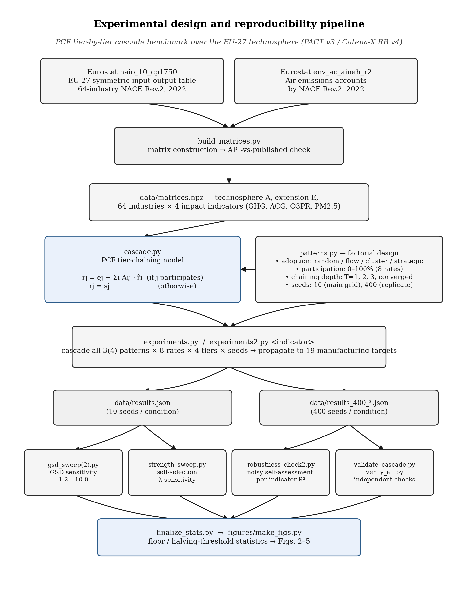

# The Scope 3 Data Dilemma: How Much Real Data Makes a Product Footprint Credible?

Companion repository for the manuscript submitted to the 34th CIRP Conference on
Life Cycle Engineering (CIRP LCE 2027):

> T. A. Khan, R. Kumar, V. Jayakumar, F. Cerdas, K. S. Sangwan, N. Khanna,
> "The Scope 3 Data Dilemma: How Much Real Data Makes a Product Footprint
> Credible?", Procedia CIRP, 34th CIRP LCE 2027.

All data are official EU statistics retrieved from public Eurostat API endpoints.
No commercial license, registration, or paid data access is required to reproduce
any result in this repository.



**Fig. A1.** Experimental design and reproducibility pipeline: Eurostat data build,
the PCF tier-chaining model crossed with the participation/depth/seed factorial
design, experiment execution, and the downstream sensitivity, validation, and
figure-generation stages. Boxes name the exact script or artifact responsible for
each stage; see [Experiment scripts](#experiment-scripts) below for the full
script-to-output mapping. Regenerate this figure with `figures/make_experiment_design_fig.py`.

## What this benchmarks

A tier-by-tier Product Carbon Footprint (PCF) cascade model, following the PACT
Methodology v3 and Catena-X PCF Rulebook v4 for cradle-to-gate footprint exchange
across supply-chain tiers (see `grounding.md` for the full model-to-standard
mapping). Supplier participation (the share of upstream industries reporting a
primary, self-measured PCF rather than a database-derived secondary factor) is
varied from 0 to 100% under three adoption patterns:

- **random** — suppliers volunteer in a uniformly random order;
- **flow** (flow-weighted) — suppliers volunteer in order of trade volume, largest
  first;
- **cluster** (sector-clustered) — suppliers volunteer by whole NACE section
  (consortia), one section at a time.

...crossed with four chaining depths (T = 1, 2, 3, and converged / fully chained),
four Eurostat-characterized impact indicators (GHG, acid gases, ozone precursors,
PM2.5), and participation rates from 0 to 100%. Every result is evaluated after
propagation through the full Leontief cascade to the nineteen manufacturing target
industries (NACE C10-12 through C33), not at the level of an individual reported
factor.

## Data build

Two Eurostat datasets, reference year 2022, geography EU27_2020:

- **naio_10_cp1750** — EU-27 symmetric input-output table, industry by industry,
  NACE Rev. 2 at 64-industry detail, current prices (million EUR).
- **env_ac_ainah_r2** — air emissions accounts by industry, NACE Rev. 2.

`code/build_matrices.py` retrieves both from Eurostat's public dissemination API
and writes the built technosphere/extension matrices to `data/matrices.npz`
(technosphere A, extension E, industry output x, intermediate-use Z, emissions F),
`data/industries.csv`, and a build-validation report (`data/checks.json`,
`data/build_check_all4.json`). Mapped-industry emissions reproduce Eurostat's
published EU-27 totals to within 0.001% for all four characterized indicators
(see `data/build_check_all4.json`). The already-built matrices are included in
`data/` so the benchmark can be rerun without re-hitting the API.

## Experiment scripts

| Script | Produces | Purpose |
|---|---|---|
| `code/build_matrices.py` | `data/matrices.npz`, `industries.csv`, `checks.json` | Data build from Eurostat |
| `code/cascade.py` | (library) | Cascade model: true PCF, secondary factors, tier-by-tier chaining, MAPE, ranking flips |
| `code/patterns.py` | (library) | Random / flow-weighted / sector-clustered / strategic participation orderings |
| `code/experiments.py` | `data/results.json`, `results.csv` | Ten-seed grid: 4 indicators x 3 patterns x 8 rates x 4 tiers x 10 seeds (3,840 conditions). The manuscript's tables and figures use the 400-seed grid from `experiments2.py` |
| `code/intervals.py` | (library) | Interval coverage and width with a tolerance for the zero-width interval at 100% participation; the mean-preserving lognormal convention as an exact affine rescaling of the draws |
| `code/check_affine_noise.py` | console | Checks the affine rescaling against a direct recomputation (max relative difference 1.4e-8) |
| `code/experiments2.py <indicator idx 0-3>` | `data/results_400_<idx>.json` (not stored in the repository) | Same grid at 400 seeds/condition, nested participant ordering shared across indicators and tier depths, plus a fourth (strategic/self-selected) adoption pattern; chunked per indicator so each chunk completes in one run (run times: `logs/timing.log` after `reproduce_all.sh`). Interval columns for both lognormal conventions (`coverage`, `coverage_m1`, `rel_width`, `rel_width_m1`) |
| `code/summarize_main.py` | `data/summary_main.json` | Table 1, Figs. 2 and 4, Fig. S2: medians, coverage and width by indicator, pattern, depth and convention, from the 400-seed grid |
| `code/equal_pds_check.py` | `data/equal_pds_check.json` | Equal-declared-PDS, cross-adoption-pattern comparison: re-plots accuracy against realized declared PDS (not raw participation rate) for random/flow/cluster, at 400 seeds/condition, converged chaining, to test whether flow-weighted's apparent accuracy advantage is genuine or a restatement of PDS itself |
| `code/gsd_sweep.py`, `gsd_sweep2.py` | `data/gsd_sweep.json`, `gsd_sweep_ext.json` | Sensitivity of interval coverage to the assumed pedigree-style GSD (1.2-3.0, extended to 10.0), both lognormal conventions (`gsd_sweep2.py` is the source of Table S4) |
| `code/strength_sweep.py` | `data/strength_sweep.json` | Self-selection strength sensitivity (gaming parameter λ) for the strategic adoption pattern discussed in Limitations |
| `code/robustness_check2.py` | `data/robustness_check2.json` | Noisy self-assessment, GHG-only selection basis, per-indicator R², bootstrap CIs |
| `code/validate_cascade.py`, `verify_all.py` | console PASS/FAIL | Independent end-to-end verification (Leontief identity, tier monotonicity, live Eurostat spot-checks against stored matrix cells) |
| `code/finalize_stats.py` | console output | Floor values and halving-participation thresholds reported in the manuscript, computed from the 400-seed grid |
| `code/pooled_pds_bins.py` | `data/pooled_pds_bins.json` | Pooled GHG error by realised PDS (all three patterns, converged chaining), Section 4.1 and Table S2b |
| `code/equal_pds_ci.py` | `data/equal_pds_ci.csv` | Bootstrap 95% intervals for the equal-PDS comparison, Table S2 (run after `equal_pds_check.py`) |
| `code/sensitivity_analysis.py` | `data/sensitivity_boot.json`, `fig2_medians_iqr.json`, `sensitivity_variants_quick.json` | Bootstrap of the halving thresholds (2,000 resamples) and a quick pass over the sensitivity variants; the Fig. 2 medians and interquartile ranges |
| `code/sensitivity_variants.py` | `data/sensitivity_variants.json` | Table 2 and Table S3: floor, halving point and 80% coverage (400 seeds x 400 draws) for the secondary-factor and primary-noise variants (run after `sensitivity_analysis.py`) |
| `code/c29_check.py` | `data/c29_check.json` | Motor vehicle industry (NACE C29) re-scored alone, Section 4.5 and Table S3b |
| `code/calibration_control.py`, `summarize_control.py` | `data/calibration_control.json`, `calibration_control_summary.json` | Factorial control for the calibration result (Section 4.3, Table S5): sector-average versus random unbiased substitute, crossed with the median- and mean-preserving convention; 100 seeds, same grid as the main experiment |
| `code/substitute_offset.py` | `data/substitute_offset.json` | Mean signed error of the sector-average substitute at zero participation and the within-section GSD (Section 4.3, Table S5c) |
| `code/chaining_depth_check.py` | `data/chaining_depth.json` | GHG error by chaining depth and participation (flow-weighted, 400 seeds) with the paired difference between one tier and converged, Section 4.2, Fig. 3 and Table S6 |
| `figures/make_fig1.py` … `make_fig4.py`, `make_figS1.py`, `make_figS2.py` | `figures/fig1_framework.png`, `fig2_error_participation.png`, `fig3_chaining_depth.png`, `fig4_coverage.png`, `figS1_cascade.png`, `figS2_indicators.png` | Figs. 1 to 4 of the manuscript and Figs. S1, S2 of the SI; Figs. 2, 4 and S2 read `data/summary_main.json`, Fig. 3 reads `data/chaining_depth.json` |

## Headline findings (as reported in the manuscript)

1. **The primary-data dividend arrives late.** At zero participation the
   database-only floor is a median error of 13.85% (GHG), 23.10% (acid gases),
   18.56% (ozone precursors), and 18.85% (PM2.5) — already a spread of nearly
   10 percentage points depending on which pollutant is reported.
2. **Recruitment order matters more than headcount.** Flow-weighted adoption
   halves the GHG floor by 60% participation; random and sector-clustered
   adoption both need a uniform 80% to do the same.
3. **Chaining depth only pays off at high participation.** At 20% participation,
   extending chaining from T=1 to converged leaves the median GHG error unchanged
   within sampling noise (12.2% against 12.0%; paired difference 0.12 points,
   standard error 0.09); at 80% participation the same extension moves error from
   8.0% down to 1.2%.
4. **Interval calibration depends on the offset of the substitute and on the lognormal
   convention.** With the median-preserving convention (the stored value is the
   median, as in ecoinvent) coverage at zero participation is 92.6% (GHG) and 48 to
   68% for the other three indicators; with a mean-preserving convention it is 82 to
   100%. Under largest-suppliers-first recruitment the mean-preserving coverage of
   acid gases, ozone precursors and PM2.5 falls to 64, 80 and 70% at 80%
   participation while the interval narrows by about 90%. A factorial control with a
   random, unbiased substitute gives near-nominal coverage under both conventions,
   so the shortfall comes from the offset of the sector-average factor, which the
   interval does not carry.
5. **Decision stability tracks participation more tightly than point error does.**
   Database-only footprints reverse about 12.6% of material pairwise
   comparisons between manufacturing industries; that rate drops to 6.1% once
   flow-weighted participation passes 40%.

## Reproducing

```
pip install -r requirements.txt
python code/build_matrices.py            # optional: matrices.npz already included (see Data vintage)
bash code/reproduce_all.sh               # everything below, in order; JOBS=2 runs two chunks at once
```

`code/reproduce_all.sh` runs, in this order: `experiments.py`, `verify_all.py`,
`check_affine_noise.py`, `experiments2.py 0..3`, `summarize_main.py`,
`calibration_control.py`, `summarize_control.py`, `substitute_offset.py`,
`gsd_sweep2.py`, the equal-PDS, pooled-PDS, sensitivity, C29 and chaining-depth
scripts, `finalize_stats.py`, and the six figure scripts. `strength_sweep.py`,
`robustness_check2.py`, `gsd_sweep.py` and `validate_cascade.py` concern the strategic
pattern and earlier checks that are not part of the manuscript and are run separately.

Run times, measured with `reproduce_all.sh` in a clean copy of the repository on two
CPU cores with `JOBS=2` (about 17 minutes in total; about 25 minutes on one core): each
`experiments2.py` chunk about 4 minutes, `calibration_control.py` about 4.5 minutes,
`gsd_sweep2.py` about 4 minutes, all other steps under 30 seconds. The timing of every step is
written to `logs/timing.log`. Every stochastic draw is seeded via an explicit
`hashlib`-derived key or `numpy.random.default_rng`, never Python's process-randomized
`hash()`. In that clean run, every JSON and CSV output in `data/` and every figure in
`figures/` matched the files in this repository (JSON to within 1e-9, figures byte for
byte), apart from the four 400-seed files, which matched as well and are not stored here.

**Data vintage.** `data/matrices.npz` holds the Eurostat tables as they were retrieved for
the manuscript. Eurostat revises published tables: a spot check in November 2026 returned
values for `naio_10_cp1750` cells that differ from the stored ones by up to 11%
(`verify_all.py`, test 1a, reports this as information, not as a failure). Rebuilding the
matrices with `build_matrices.py` may therefore give slightly different numbers than the
manuscript; all results here are computed from the stored matrices.

**Data availability note:** this GitHub copy omits the four 400-seed replicate files
(`data/results_400_0.json` … `results_400_3.json`, about 85 MB in total) and
`data/calibration_control.json` (7.5 MB) to keep the repository small. `reproduce_all.sh`
regenerates them, or they can be requested from the corresponding author. The small summary
files that the tables and figures read (`summary_main.json`, `calibration_control_summary.json`)
are stored.

## Limitations

- Three patterns and eight participation rates are simulated at an input-output
  testbed resolution of 64 industries, not a process-based inventory.
- The strategic/self-selected adoption pattern is one specification of a
  supplier-favorability-driven volunteering rule; `strength_sweep.py` explores
  its sensitivity to the assumed gaming strength, but it has not been validated
  qualitatively against real disclosure decisions (see the manuscript's
  Limitations section).
- Monte Carlo interval estimates use a fixed lognormal secondary-factor GSD of
  2.0 as the baseline assumption, with the stored value as the median of the
  distribution (the ecoinvent convention); a mean-preserving variant is reported
  alongside. `gsd_sweep2.py` tests sensitivity to the GSD across 1.2-10.0 for both
  conventions.

## Declaration of AI use

Declaration of Generative AI and AI-assisted technologies in the research process. During the preparation of this work, the author(s) used Claude (Anthropic) to run simulated multi-reviewer critiques of the manuscript before submission and after review, to help condense the manuscript to the conference's page limit, and to assist with language editing and reference checking. Claude was also used to support and organize  supplementary analysis scripts in this repository (`equal_pds_check.py`, `equal_pds_ci.py`, `pooled_pds_bins.py`, `sensitivity_analysis.py`, `sensitivity_variants.py`, `c29_check.py`, `calibration_control.py`, `summarize_main.py`, `summarize_control.py`, `substitute_offset.py`, `intervals.py` and `chaining_depth_check.py`) that address questions raised by reviewers, and to prepare the revised manuscript, the supplementary information and the response letter. All resulting suggestions, code and edits were evaluated by the author(s), who take full responsibility for the content of the publication and of this repository.

## License

Code in this repository is released under the MIT License (see `LICENSE`). The
underlying Eurostat-derived data (`data/matrices.npz`, `industries.csv`) are
reusable under Eurostat's own terms, which require acknowledgement of the
source; see https://ec.europa.eu/eurostat/about/policies/copyright.
